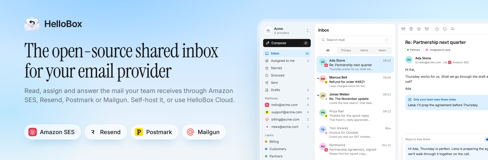
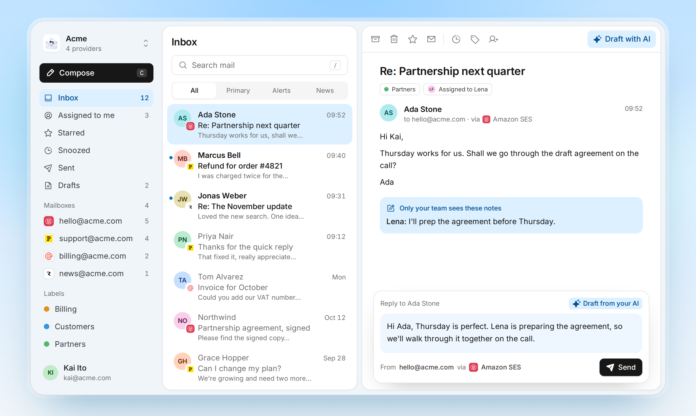

## HelloBox

HelloBox is an open-source shared inbox for teams that send email through **Amazon SES**,
**Resend**, **Postmark** or **Mailgun**. It receives the replies through your own provider
account, shows them to your whole team in one inbox, and sends your answers back through the
same provider, from your own domain. You keep your provider, your domains and your sending
reputation.

### What it does

- **One inbox for every provider.** Connect Amazon SES, Resend, Postmark and Mailgun, and
  read all their inbound email side by side. HelloBox sets up the inbound webhooks, receipt
  rules and routes for you.
- **Shared mailboxes for teams.** `support@`, `hello@`, `billing@`: assign conversations,
  leave internal notes only your team sees, and use labels and team views.
- **Replies from your own domain.** Answers go out through your provider, under your SPF and
  DKIM, with delivery and bounce events tracked.
- **Spam filtering, rules, contacts and templates,** built in.
- **AI drafts with your own key,** and an MCP server for AI agents. Nothing is sent unless a
  person allowed it.
- **Self-hosted or cloud.** Run it on your own server with Docker Compose, or use
  [HelloBox Cloud](https://hellobox.app).

### Repositories

- [**hellobox**](https://github.com/HelloboxGH/hellobox): the app, licensed under
  AGPL-3.0. Self-hosting guide, contributing guide and issues are there.

### Links

[Website](https://hellobox.app) ·
[Self-hosting guide](https://github.com/HelloboxGH/hellobox/tree/main/docs/self-hosting) ·
[Discussions](https://github.com/HelloboxGH/hellobox/discussions) ·
[Contributing](https://github.com/HelloboxGH/hellobox/blob/main/CONTRIBUTING.md)
